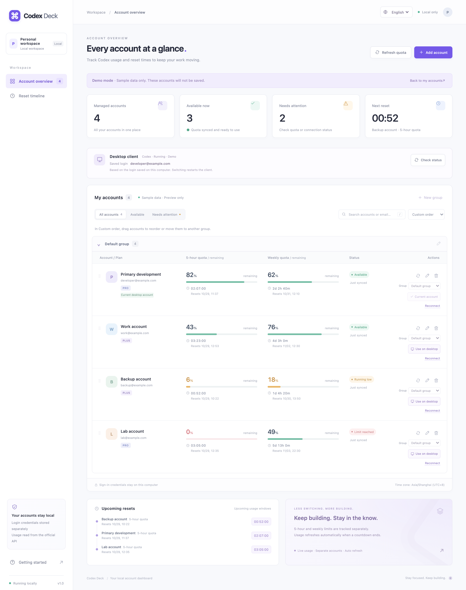

# Codex Deck

在本机集中管理多个 Codex 账号，查看 **5 小时 / 每周剩余额度、重置倒计时和重置时间**，并按需切换 Codex 桌面客户端的登录账号。

[](docs/images/dashboard-demo.png)

*完整页面预览 · 英文界面 · 全部为演示数据，不含真实账号信息。点击图片查看高清原图。*

项目使用原生 Node.js、HTML、CSS 和 JavaScript，**没有第三方运行依赖，无需构建或执行 `npm install`**。账号通过官方授权页登录，凭据保存在本机；无需配置 OpenAI API Key。

默认页面：**[http://127.0.0.1:4317](http://127.0.0.1:4317)**

当前项目目录：`/Users/phynero/codexMng`。下文命令以此为例，在其他位置使用时请替换目录。

## 目录

- [功能与适用范围](#功能与适用范围)
- [环境准备](#环境准备)
- [快速开始](#快速开始)
- [界面语言与偏好保存](#界面语言与偏好保存)
- [启动与停止命令](#启动与停止命令)
- [开机自启与重启后的登录](#开机自启与重启后的登录)
- [添加和管理账号](#添加和管理账号)
- [账号分组与拖动排序](#账号分组与拖动排序)
- [如何理解额度与状态](#如何理解额度与状态)
- [切换桌面客户端账号](#切换桌面客户端账号)
- [本地数据与凭据](#本地数据与凭据)
- [配置端口路径与网络](#配置端口路径与网络)
- [备份恢复与迁移](#备份恢复与迁移)
- [常见问题与排查](#常见问题与排查)
- [开发与测试](#开发与测试)
- [本地接口参考](#本地接口参考)
- [项目结构与实现](#项目结构与实现)
- [参考资料](#参考资料)

## 功能与适用范围

| 功能 | 当前行为 |
| --- | --- |
| 多账号管理 | 添加、重命名、重新授权、删除管理记录；最多 100 条 |
| 额度概览 | 展示剩余百分比、重置倒计时、重置时间和最后同步时间 |
| 多额度类型 | 保留上游返回的不同额度类型，可在账号内切换查看 |
| 自动同步 | 后端每 60 秒读取额度；可手动刷新单个或全部账号 |
| 查询与排序 | 按名称 / 邮箱搜索、按状态筛选、按额度或重置时间排序；支持保存自定义拖动顺序 |
| 账号分组 | 新建、重命名、删除分组；每个账号归属一个分组，新账号进入默认分组 |
| 分组展开状态 | 点击分组标题展开或折叠，在同一浏览器中保留上次状态 |
| 中英文界面 | 首次默认英文，顶部切换 English / 中文，记住当前浏览器的选择 |
| 重置时间线 | 显示最近即将重置的额度窗口 |
| 桌面端切换 | 确认后备份登录、退出客户端、应用账号并重新打开 |
| 登录恢复 | 恢复最近一次桌面端切换前的登录状态 |
| 开机自启 | macOS 用户登录后启动，后台服务由系统管理 |
| 演示模式 | 使用内存中的示例账号预览页面与切换弹窗 |

目前主要在 **macOS** 上开发和验证。桌面客户端切换、开机自启和 `启动.command` 仅支持 macOS。其他系统尚未完成实机兼容验证。

本项目读取 **ChatGPT 登录账号的 Codex 订阅额度**，不提供 API Key 账单查询、固定剩余调用次数估算，也不会在额度用尽时自动更换账号。多账号监控不会合并账号额度或改变官方限制。

页面可适配窄屏，但服务仅监听本机 `127.0.0.1`；手机或局域网中的另一台设备不能直接访问这台电脑上的服务。

## 环境准备

需要：

- Node.js **18.15 或更新版本**，以及与该 Node.js 版本兼容的 npm。
- 可执行的 Codex CLI；已使用 `codex-cli 0.149.0` 验证账号接口与临时令牌模式。
- 能访问官方授权和额度服务的网络环境。
- 如需桌面切换，还需安装受支持的 Codex 桌面客户端，具体条件见[切换桌面客户端账号](#切换桌面客户端账号)。

先检查工具是否可用：

```sh
node --version
npm --version
codex --version
```

未安装 Codex CLI 时：

```sh
npm install -g @openai/codex
codex --version
```

这里的全局安装用于获取 **Codex CLI**；项目本身不需要安装 npm 依赖。

## 快速开始

### 方式一：启动并启用开机自启

在 Finder 中双击项目内的 `启动.command`，或在终端运行：

```sh
cd /Users/phynero/codexMng
./启动.command
```

脚本会依次：

1. 检查 Node.js，并为工具查找补充常见的 Homebrew 路径。
2. 安装或更新当前用户的开机自启配置。
3. 启动后台服务并确认页面接口已就绪。
4. 在默认浏览器打开管理页面。

配置未改变时重复执行不会额外启动一份服务。若文件复制后丢失执行权限，可先运行 `chmod +x 启动.command`。

**这个脚本会启用开机自启。** 如果只想手动启动，使用下面的方式。

### 方式二：手动启动后台

```sh
cd /Users/phynero/codexMng
npm start
```

没有安装自启时，该命令启动独立后台进程，关闭终端或 Codex 桌面端后仍可运行。已有自启配置时，它会启动或复用系统托管的服务。

打开 [管理页面](http://127.0.0.1:4317)，点击 **Add account（添加账号）**，完成一次官方授权后即可看到额度。已有桌面登录不会自动成为管理列表中的账号。

页面首次以英文显示；可以在顶部的语言选择框切换为「中文」。下文操作教程使用中文界面按钮名，英文对应名称见[界面语言与偏好保存](#界面语言与偏好保存)。

### 方式三：前台运行，便于调试

先暂停已运行的后台服务，再启动前台服务：

```sh
npm stop
npm run dev
```

前台输出显示在当前终端，按 `Control+C` 停止。尚未启动过后台时，可直接运行 `npm run dev`；此模式不会安装自启。

## 界面语言与偏好保存

页面支持 **English** 和 **中文**。没有已保存偏好时固定使用英文，不随系统或浏览器语言自动切换。点击页面顶部的语言选择框即可即时切换，无需刷新或重新连接账号；按钮、弹窗、状态、倒计时和错误提示会使用所选语言。账号备注、邮箱及上游额度类型名称保留原始内容。

语言选择使用浏览器 `localStorage` 保存，键名为 `codex-deck.language`，值为 `en` 或 `zh-CN`。在**同一浏览器、同一网站来源**下，刷新页面、关闭后重新打开、重启本机服务或电脑后，都会继续使用保存的选择。这里的网站来源包括协议、主机名和端口：`http://127.0.0.1:4317` 与 `http://localhost:4317`，以及不同端口，是不同的保存位置。

清除站点数据、更换浏览器或访问地址后需要重新选择。无痕窗口的偏好通常在关闭无痕会话后清除。浏览器禁止本地存储时，当前页面仍能切换语言，但会提示无法保存；下次打开时无法保证沿用本次选择。

语言偏好保存在浏览器中，不属于 `data/` 账号备份，也不绑定某个 Codex 账号。切换界面语言不会改变管理账号、凭据、额度或桌面客户端的登录状态。**重置时间始终使用 `Asia/Shanghai`（UTC+8）**，只调整日期及文字的显示格式，不随界面语言更改时区。

常用按钮对照：

| 中文界面 | 英文界面 |
| --- | --- |
| 添加账号 | Add account |
| 浏览器登录 | Browser sign-in |
| 设备验证码 | Device code |
| 添加并登录 | Add and sign in |
| 打开官方授权页 | Open official sign-in page |
| 继续授权 | Continue sign-in |
| 重新连接 | Reconnect |
| 移除账号 | Remove account |
| 查看演示 | View demo |
| 检测状态 | Check status |
| 切换到桌面端 | Use on desktop |
| 确认切换并重启 | Switch and restart |
| 恢复上次登录 | Restore previous login |

## 启动与停止命令

所有命令均在项目目录中执行。

| 命令 | 用途 | 是否影响下次登录自启 |
| --- | --- | --- |
| `./启动.command` | 安装 / 更新自启、启动服务、打开浏览器 | 启用自启 |
| `npm start` | 启动或复用后台服务 | 有自启配置时启用并使用它；没有时不创建配置 |
| `npm stop` | 停止当前后台服务 | 保留已有自启配置，下次登录仍会启动 |
| `npm run status` | 查看后台状态和访问地址 | 不修改 |
| `npm run dev` | 在前台运行服务 | 不修改 |
| `npm run autostart:enable` | 安装 / 更新自启并立即启动 | 启用自启 |
| `npm run autostart:status` | 检查自启登记和当前服务健康情况 | 不修改 |
| `npm run autostart:disable` | 停止系统托管服务，关闭并移除自启登记 | 关闭自启；保留账号数据 |

普通后台进程用 `npm stop` 停止，前台进程在原终端按 `Control+C` 停止。`autostart:disable` 用于系统托管服务，不代替这两种停止方式。

若 npm 与 Node.js 的版本不兼容，可以直接使用等价命令：

```sh
node server/service.mjs start
node server/service.mjs stop
node server/service.mjs status
node server/autostart.mjs install
node server/autostart.mjs status
node server/autostart.mjs uninstall
```

## 开机自启与重启后的登录

### 自启在什么时候发生

自启登记文件位于：

```text
~/Library/LaunchAgents/local.codex-account-deck.plist
```

服务在**当前用户登录 macOS 图形界面后**自动启动，不是登录前的系统服务，也不需要管理员权限。系统自启时不会弹出终端或浏览器；需要查看额度时打开管理页面即可。

配置使用 `RunAtLoad` 和 `KeepAlive`：登录后启动，进程退出后由系统重新拉起，并设有重试间隔。通过 `npm stop` 正常暂停会卸载本次运行的服务，避免系统立即把它启动回来；自启登记仍保留。

检查结果应包含：

```text
开机自启：已启用（登录 macOS 后）
当前服务：运行正常
页面地址：http://127.0.0.1:4317
```

“已登记”不一定代表服务已成功启动，应同时确认「当前服务」和页面能否访问。此前已验证配置语法、重新加载后的启动和重复安装行为；不依赖重启整台电脑来完成安装。

### 重启后是否需要重新登录

**正常情况下不需要。** 账号列表、额度缓存和登录凭据都保存在磁盘上，停止服务、退出应用和重启电脑不会主动删除它们。Codex 会复用已保存的登录状态；授权失效、被撤销或认证文件被删除等情况下才可能需要重新连接。

桌面当前账号有一点区别：管理器使用桌面端保存的访问令牌读取额度，不独立更新该会话的刷新令牌。如果桌面端关闭较久、访问令牌已过期，先打开 Codex 桌面端让它更新登录，再刷新管理页；这不一定意味着需要重新授权。官方的登录缓存与令牌刷新说明见[认证文档](https://learn.chatgpt.com/docs/auth)。

开机时还没联网，页面可能先显示缓存或读取失败；联网后会继续按正常周期重试。倒计时到期并不能代替一次成功的额度同步。

### 自启如何保存运行环境

安装时会保存 Node、Codex CLI、项目目录、数据目录和端口的固定配置，并设置独立的 `HOME`、`PATH`。登录自启不依赖某个终端窗口，也不会读取你的 `.zshrc` 来更新这些配置。

代理和证书环境变量同样是**安装时的快照**。修改路径、端口或代理后，需要重新运行 `npm run autostart:enable`，详见[配置端口路径与网络](#配置端口路径与网络)。

## 添加和管理账号

### 浏览器授权

1. 点击「添加账号」，填写用于区分账号的备注名。
2. 选择「浏览器登录」，点击「添加并登录」。
3. 点击「打开官方授权页」，在官方页面完成登录。
4. 返回管理页，等待状态从「等待授权」变为已连接并显示额度。
5. 添加下一个账号时，确认官方授权页选中的是另一个账号。必要时在无痕窗口中打开授权链接。

备注名须为 1–60 个字符，不能包含控制字符。最多保存 100 条管理记录。

同一用户和同一工作区只保留一条记录；重复连接会显示提示，避免多个管理进程同时更新同一登录会话。连接错账号时，可重新授权为正确账号，或移除重复记录。

备注名称不用于判断登录身份。若授权页选中了列表中已有的账号，即使填写不同备注，也会被判为重复。页面会显示凭据中的实际邮箱、冲突的已有记录，并提供「查看已有账号 / View existing account」按钮；该按钮会清除搜索和状态筛选，定位到原记录。重复记录不显示旧账号留下的额度，避免误认。

### 设备验证码授权

如果浏览器授权的本机回调端口被占用，可以选择「设备验证码」：

1. 发起登录，获取验证码及官方验证地址。
2. 打开该地址，按官方页面提示输入验证码并确认账号。
3. 返回管理页等待连接完成。

设备登录是否可用取决于账号和官方设置，可能需要在 ChatGPT 安全设置中启用。若官方页面提示不可用，改用浏览器登录。

### 授权过程的行为

- 同一时间只允许一个账号进行授权，完成或取消后才能连接下一个。
- 一次授权等待最多 10 分钟，超时后需要重新发起。
- 关闭登录弹窗不等于取消授权；账号行可点击「继续授权」。
- 浏览器授权回调通常使用 `1455` 端口，与管理页的 `4317` 端口独立。
- 密码和验证码应在官方流程中处理；项目不会要求你把 `auth.json` 或访问令牌粘贴到网页。

### 重命名、重新连接和删除

| 操作 | 影响 |
| --- | --- |
| 重命名 | 修改管理列表中的备注，不改变官方账号信息 |
| 刷新额度 | 重新读取额度，成功后更新缓存与同步时间 |
| 重新连接 | 重新发起官方授权，可修复失效登录或改为另一个账号 |
| 移除账号 | 停止该条记录的监控，删除该记录和它的独立登录目录 |

**移除管理记录不会删除 OpenAI 账号、撤销服务端授权或退出桌面客户端，也不会清理桌面切换备份。** 如果希望停止官方会话，应使用官方提供的退出或授权管理功能。

删除成功会移除运行中的记录、`data/accounts.json` 中对应条目及 `data/accounts/<账号 ID>/` 整个目录，并关闭该条记录的监控进程。删除时的异步凭据查询不能再启动该记录的监控。若移除的是较早的重复记录，保留的另一条记录会自动重新检查连接。全部重复记录删除后，可以重新添加同一账号；请在官方授权页确认实际登录邮箱。桌面登录和切换备份不参与管理列表的重复校验。

### 演示模式

「查看演示」使用内存中的示例账号，不会把它们保存到 `data/`。可以预览页面和切换确认弹窗，但确认预览不会发送真实切换请求。

退出演示或刷新页面会回到真实账号。点击添加真实账号会离开演示模式。演示期间已有真实账号的后台同步仍照常运行。

## 账号分组与拖动排序

已有账号首次升级后会按原顺序进入**默认分组 / Default group**。以后新添加的账号也会先进入这个分组；每个账号只能属于一个分组。分组只用于本页面管理，不改变账号的官方工作区或额度。

### 新建、重命名与删除分组

- 在「我的账号」右侧点击「新建分组 / New group」，输入名称并保存。没有账号时也可以提前创建分组。
- 点击分组标题右侧的铅笔图标修改名称；名称为 1–40 个字符，同名分组不可重复创建。最多保存 50 个分组，包含默认分组。
- 点击垃圾桶图标并确认后删除分组，组内所有账号会移回默认分组，账号、凭据和额度记录保留。
- 默认分组可以重命名，但不能删除；即使改名，新账号和被删除分组中的账号仍会归入它。

### 账号归组与排序

账号行的「分组 / Group」下拉框可以指定归属；也可以把账号拖到其他分组标题或空分组区域。移动到分组标题或空白处会排在该组末尾，折叠的分组也可以接收拖入的账号。

排序选择「自定义顺序 / Custom order」后，拖动账号左侧的六点手柄调整位置：拖到另一个账号上半部会插入它之前，下半部插入它之后。拖动过程中会暂停重绘账号列表，后台仍可读取最新状态。也可以聚焦六点手柄，按 `Alt+↑` 或 `Alt+↓` 在组内移动。

按名称、额度或重置时间排序时，分组内使用对应的临时排序，拖动手柄会禁用；切回「自定义顺序」会恢复上次保存的手动顺序。搜索与状态筛选不会删除或重排隐藏的账号。

分组定义、账号的 `groupId` 和排序值 `order` 保存在 `data/accounts.json`，刷新页面、重启服务或电脑后保留，也随账号数据备份。排序不会改变重复账号监控所依据的原始记录顺序。

### 记住展开与折叠状态

点击分组标题切换展开或折叠。该状态使用浏览器 `localStorage` 的 `codex-deck.groups.expanded` 保存，刷新、关闭并重新打开浏览器后继续使用；同一浏览器中的其他管理页标签也会同步。新分组默认展开。

展开状态按浏览器和访问来源保存，不属于 `data/` 备份；清除站点数据、更换浏览器、主机名或端口后会恢复默认展开。浏览器禁止本地存储时，本次仍可展开和折叠，页面会提示无法保存。

## 如何理解额度与状态

### 显示的百分比

页面显示的是**剩余百分比**：

```text
剩余百分比 = max(0, min(100, 100 - usedPercent))
```

例如上游返回已使用 `27%`，页面显示剩余 `73%`。这不是精确的剩余消息数、Token 数或可连续使用的小时数。

| 信息 | 解释 |
| --- | --- |
| 5 小时额度 | 优先匹配周期为 300 分钟的额度窗口 |
| 每周额度 | 优先匹配周期为 10080 分钟的额度窗口 |
| 重置倒计时 | 距上游返回的 `resetsAt` 还有多久 |
| 重置时间 | 以 `Asia/Shanghai`（UTC+8）显示的日期和时间 |
| 最后同步 | 最近一次成功读取额度的时间，不是页面最近刷新时间 |
| `—` / 暂无数据 | 上游未提供可用数据，不代表额度为零 |

非标准周期会显示实际周期，例如 24 小时或若干天；缺少周期信息时会显示周期未知。不会仅凭 `primary` / `secondary` 的位置推断哪一个是周额度。

如果上游返回多个额度类型，优先保留 `rateLimitsByLimitId` 的全部条目；旧版接口兼容 `rateLimits`。不同类型的额度分别展示，不能直接相加。账号总体状态综合其所有已返回的额度窗口，因此切换查看的某个类型还有额度时，总体状态仍可能提示其他类型受限。

### 页面状态

| 状态 | 含义和建议 |
| --- | --- |
| 等待授权 | 正在等待官方登录完成 |
| 待连接 | 尚未登录，或登录需要重新确认 |
| 连接异常 | 读取失败等情况；查看账号行的具体原因 |
| 重复账号 | 与另一条记录持有相同登录身份；点击「查看已有账号」定位该记录 |
| 暂无额度 | 没有完整、可用的额度数据 |
| 等待同步 | 已到重置时间，或上次成功数据超过 3 分钟 |
| 额度已用尽 | 至少一个已知窗口剩余为 0% |
| 额度偏低 | 至少一个已知窗口剩余不高于 20% |
| 额度充足 | 已返回的窗口数据有效，且均高于低额度阈值 |

「当前可用」统计状态为「额度充足」和「额度偏低」的账号，连接异常或数据过期的账号不计入。这个数值基于已有额度快照，不是对下一次官方请求是否成功的保证。

### 刷新频率

| 层级 | 默认频率 | 说明 |
| --- | --- | --- |
| 后端读取上游额度 | 每 60 秒 | 关闭页面后仍继续，最多并行处理 3 个账号 |
| 可见页面读取本地状态 | 每 3 秒 | 从本机服务取数据，不是每 3 秒请求官方额度 |
| 页面倒计时 | 每秒 | 使用现有重置时间在本地计算 |
| 到期后的额外刷新 | 每账号最多每分钟一次 | 页面发现到期窗口后尝试刷新 |

窗口到期后显示「已到重置时间 · 等待同步」，只有上游的新数据才能确认恢复，不会自行把额度改成 100%。读取失败时保留最近一次成功数据，并显示错误或过期状态。

## 切换桌面客户端账号

### 支持条件

当前实现通过本机登录文件和客户端重启切换账号。需要同时满足：

- macOS，且在 `/Applications/ChatGPT.app` 或 `/Applications/Codex.app` 找到应用标识为 `com.openai.codex` 的客户端；文件夹同名本身不代表支持。
- 使用默认桌面登录目录 `~/.codex` 和文件凭据存储 `file`。
- 所选账号已在本项目连接，且切换前能成功读取额度。
- 没有其他进行中的账号授权或桌面切换任务。
- 其他 Codex CLI / 编辑器扩展进程已经关闭，登录配置与工作区限制允许切换。

检测采用保守策略：独立运行的其他 Codex CLI 即便使用不同目录，也可能导致切换被阻止。只打开 VS Code 本身并不一定有影响，运行中的 Codex 扩展或 CLI 会影响判断。

`keyring`、`auto`、`ephemeral` 凭据存储、自定义 `CODEX_HOME`、受管理或无法安全解析的登录配置、多个桌面实例等情况会禁用切换。页面会显示具体原因，项目不会自动改写这些设置。

### 操作步骤

1. 在网页中连接目标账号。
2. 完成或停止 Codex 桌面端正在进行的任务，关闭其他 Codex CLI / 扩展会话。
3. 点击桌面客户端面板的「检测状态」。
4. 在目标账号行点击「切换到桌面端」。
5. 阅读提示，点击「确认切换并重启」。
6. 等待客户端重新打开，并在客户端内确认实际账号。

**切换会退出并重启桌面客户端，正在运行的任务会被中断。** 默认 Codex CLI 和编辑器扩展可能共用该登录文件，之后也会读到所选账号。

页面里的「桌面端当前账号」依据磁盘上保存的登录信息识别，不代表已经验证正在运行的客户端内存中的身份。

### 切换过程与结果

| 阶段 | 后端行为 |
| --- | --- |
| 准备 / 排队 | 验证账号、配置和客户端状态，暂停管理器刷新，关闭相关监控进程 |
| 退出客户端 | 请求正常退出，并等待桌面及相关 Codex 子进程退出 |
| 备份与写入 | 读取退出后的最新登录、同步回对应管理账号、保存备份，再写入目标登录 |
| 重新打开 | 启动已验证路径中的应用，等待检测到应用进程 |
| 完成 | 保存操作结果，恢复后台监控 |

桌面退出等待约 15 秒；未正常退出时取消切换，不自动强杀桌面进程。操作由独立后台任务执行，客户端关闭后可重新打开管理页查看结果。

「完成」表示登录文件已写入、应用进程已重新出现，不等同于服务端已确认新账号登录成功。若应用启动失败、未检测到仍在运行的桌面或其他 Codex 客户端，且登录文件未被其他进程改变，会尝试恢复原登录；如果检测到并发变化，则保留现状并提示检查，不覆盖其他客户端的新登录。

### 恢复上次登录

桌面面板中的「恢复上次登录」会执行同样的退出、写入和重启流程。

- 只保留**最近一次写入前的一份备份**，不是多版本历史记录。
- 每次切换和恢复都会更新这份备份。
- 如果原先没有登录，恢复会还原为未登录状态。
- 备份账号仍在管理列表时，优先使用它最新的可用凭据，避免还原过时的刷新令牌。
- 备份账号已不在列表时使用保留的备份；旧授权可能已经过期或被撤销，不能保证长期有效。

## 本地数据与凭据

默认数据目录是项目根目录下的 `data/`；可以通过 `CODEX_MANAGER_DATA_DIR` 修改。

```text
data/
├── accounts.json                 # 分组、账号归属与顺序、备注、最近一次额度快照
├── accounts/
│   └── <UUID>/                   # 每条管理记录独立的 CODEX_HOME
│       ├── config.toml           # 文件凭据存储等隔离配置
│       ├── auth.json             # 官方登录产生的凭据，含敏感令牌
│       └── ...                   # Codex 运行时可能产生的其他文件
├── desktop/
│   ├── backup.json               # 最近一次桌面切换前的登录备份，含敏感凭据
│   ├── status.json               # 操作状态，不含令牌
│   ├── staged.json               # 切换期间的待应用凭据，结束后清理
│   ├── operation.json            # 切换期间的执行参数，结束后清理
│   └── active.lock/              # 切换期间的互斥标记，结束后清理
├── service.json                  # 普通后台模式的进程实例记录
├── service.log                   # 普通后台模式日志
├── autostart.log                 # 系统托管服务的标准输出
└── autostart-error.log           # 系统托管服务的标准错误
```

这些文件按使用情况创建，不是首次启动就全部存在。系统托管模式使用 LaunchAgent 管理进程，不依赖 `service.json`。

### 两套登录数据的区别

| 位置 | 用途 |
| --- | --- |
| `data/accounts/<UUID>/auth.json` | 本项目管理的账号凭据 |
| `~/.codex/auth.json` | 默认桌面端 / CLI / 扩展使用的登录 |
| `data/desktop/backup.json` | 本项目最近一次桌面切换前的备份 |

添加账号不会直接替换默认桌面登录；确认切换或恢复后才会更新默认登录文件。普通管理账号由官方 CLI 处理令牌更新。与桌面当前身份相同的账号采用临时访问令牌模式监控，避免独立进程同时刷新同一个会话。

### 保存与访问边界

账号及私有数据目录权限为 `0700`，认证文件、元数据和自启日志使用 `0600`。这是文件权限保护，**不是磁盘内容加密**。`data/`、`.env*`、日志所在目录和临时产物已通过 `.gitignore` 排除。

后端不会把访问令牌、刷新令牌发送给网页，也不会在正常日志中打印它们。授权链接和设备验证码属于登录流程，会在对应弹窗中显示。

服务只监听回环地址，并检查 Host、Origin、请求内容类型及跨站请求。它面向受信任的本机用户，没有独立的网页登录密码或远程权限系统，不应直接通过反向代理暴露到公网。备份文件与 `auth.json` 同样包含可用于登录的敏感内容，不要提交到仓库或上传到问题反馈中。

## 配置端口路径与网络

### 可用环境变量

| 变量 | 默认值 | 用途 |
| --- | --- | --- |
| `PORT` | `4317` | 网页服务端口；后台 / 自启使用 1–65535 |
| `CODEX_BIN` | 从 PATH 查找 `codex` | 指定 Codex CLI，可使用绝对路径 |
| `CODEX_MANAGER_DATA_DIR` | `<项目目录>/data` | 管理账号、缓存和桌面备份的存储目录 |
| `HTTP_PROXY` / `HTTPS_PROXY` / `ALL_PROXY` / `NO_PROXY` | 未设置 | 上游网络代理；也支持小写形式 |
| `SSL_CERT_FILE` / `SSL_CERT_DIR` | 未设置 | 证书文件或目录 |
| `NODE_EXTRA_CA_CERTS` / `CODEX_CA_CERTIFICATE` | 未设置 | Node / Codex 额外证书配置 |

`CODEX_HOME` 与 `CODEX_MANAGER_DATA_DIR` 不同：每个管理账号使用独立的 `CODEX_HOME`，不直接继承外部同名变量；自定义桌面 `CODEX_HOME` 不属于当前网页切换的支持范围。

项目没有自动读取 `.env` 的功能。请通过命令前的环境变量或 shell `export` 设置。刷新周期和展示时区目前是代码中的默认设置，未提供网页配置或对应环境变量。

### 未安装自启时

先停止旧实例，再以新配置启动，例如：

```sh
PORT=4320 \
CODEX_BIN=/opt/homebrew/bin/codex \
CODEX_MANAGER_DATA_DIR=/Users/phynero/codexMng/data \
npm start
```

更改普通后台的端口后，查询 / 停止时也应使用一致的配置。重复 `npm start` 不会自动重启现有实例或热更新它的环境。

### 已安装自启时

`npm start`、`npm stop` 和 `npm run status` 会使用 **已保存的 LaunchAgent 配置**。仅运行 `PORT=4320 npm start` 不会把已有自启服务切换到新端口。

应重新安装配置：

```sh
PORT=4320 \
CODEX_BIN=/opt/homebrew/bin/codex \
CODEX_MANAGER_DATA_DIR=/Users/phynero/codexMng/data \
npm run autostart:enable
```

随后运行 `npm run autostart:status`，按输出的地址访问页面。

**重新安装时，未提供的配置项会回到默认值，不自动继承上次的自定义值。** 使用自定义端口、数据路径或代理时，更新配置应一并提供所有需要保留的值；无环境变量地双击启动脚本也会按默认配置更新。

### 代理示例

以下地址仅是示例，需替换为本机实际可用的代理端口：

```sh
HTTPS_PROXY=http://127.0.0.1:7890 \
HTTP_PROXY=http://127.0.0.1:7890 \
NO_PROXY=127.0.0.1,localhost \
npm run autostart:enable
```

自启只保存明确允许的代理、证书和运行环境，不会将整个 shell 环境或 API Key 写进配置。代理地址如包含密码，也应把 LaunchAgent 配置视为私有文件。

## 备份恢复与迁移

### 备份管理数据

1. 等待授权和桌面切换完成。
2. 通过 `npm stop` 暂停后台；若是前台模式，先在原终端停止进程。
3. 将整个数据目录备份到私人、安全的位置。使用自定义数据目录时，备份该目录而非默认 `data/`。
4. 备份后运行 `npm start` 恢复服务。

默认目录的备份示例：

```sh
cd /Users/phynero/codexMng
npm stop
umask 077
backup_file="$HOME/codex-deck-backup-$(date +%Y%m%d-%H%M%S).tar.gz"
tar -czf "$backup_file" data
npm start
```

压缩包仍是未加密的凭据备份。它不包含项目外的 `~/.codex/auth.json` 或系统自启登记。令牌可能继续轮换或被撤销，旧备份不能保证恢复后永久免登录。

### 从数据备份恢复

1. 停止服务，确认没有进行中的切换。
2. 先另行保留现有数据目录，不直接覆盖唯一副本。
3. 解压备份，把完整目录放到当前配置的 `CODEX_MANAGER_DATA_DIR` 位置，保持它由当前用户拥有。
4. 启动服务，核对账号列表、连接状态和额度同步时间；个别授权失效时重新连接。

数据目录和凭据路径不能依赖符号链接，相关安全检查会拒绝这些路径。恢复管理数据不会自动恢复某一桌面账号；需要时仍通过网页的切换 / 恢复操作完成。

### 移动项目目录

先等待所有账号授权与桌面切换完成，再进行下面的移动流程。切换任务独立于管理服务，单独停止服务不能保证它已结束。

1. 在旧目录运行 `npm run autostart:disable`，停止并移除旧路径的自启登记。未安装自启时用 `npm stop`，前台模式按 `Control+C`。
2. 移动整个项目，保留 `data/`、`.gitignore` 等隐藏文件。只重新克隆代码不会带回被 Git 忽略的账号数据。
3. 在新目录运行 `./启动.command`，或带上所需自定义配置执行 `npm run autostart:enable`。
4. 运行 `npm run autostart:status`，确认地址正常、账号列表完整。

如果数据位于项目外，移动项目不会移动数据；重新安装自启时继续指定原来的 `CODEX_MANAGER_DATA_DIR`。Node 或 Codex CLI 安装路径改变后，也需更新自启配置。

### 停用或移除项目

先关闭自启并停止服务，再移走项目文件。`autostart:disable` 本身保留账号数据；是否保留或删除 `data/` 由你决定。删除本项目不会替你退出桌面端，也不会撤销官方会话。

## 常见问题与排查

### 先做这些只读检查

```sh
cd /Users/phynero/codexMng
npm run status
npm run autostart:status
node --version
codex --version
curl --fail http://127.0.0.1:4317/api/service
```

自定义端口时替换 URL。查看当前运行模式对应的日志：

```sh
# 系统托管模式
tail -n 60 data/autostart-error.log
tail -n 60 data/autostart.log

# 普通后台模式
tail -n 60 data/service.log
```

自定义数据目录时相应替换日志路径。日志按需创建，没有运行过对应模式时文件可能不存在。目前没有自动日志轮转；需要归档时先停止服务。

### 问题对照

| 现象 | 原因或处理方式 |
| --- | --- |
| 页面打不开 / 本地服务已断开 | 运行 `npm run status` 和 `npm start`，按实际输出地址访问；不要直接双击打开 `public/index.html` |
| 端口被占用 | 先确认占用进程是否为本项目；停止旧实例，或按对应运行模式修改 `PORT`，不要直接结束不明进程 |
| 启动后仍看到旧代码 | 后端没有自动热重载；停止后重新启动。前端修改后刷新浏览器 |
| 刷新后语言又变为英文 | 检查是否使用同一浏览器和访问地址、是否清除了站点数据，以及浏览器是否允许本地存储；在顶部重新选择语言 |
| 提示未检测到 Codex CLI | 检查 `codex --version`，指定正确的 `CODEX_BIN` 后重启；自启模式需重新安装配置 |
| npm 提示不支持当前 Node 版本 | 使用匹配的 Node / npm，或用本文中的 `node server/...` 等价命令；项目无 npm 依赖 |
| 登录页打开，但授权没有完成 | 确认选中的账号，查看回调端口是否被占用；取消后重试或改用设备验证码 |
| 设备登录不可用 | 按官方页面检查账号设置，或改用浏览器授权 |
| 提示此账号已在列表中 | 点击「查看已有账号」定位冲突记录；按实际邮箱核对授权，保留一条，其余改连不同账号或移除 |
| 备注是一个邮箱，实际登录邮箱却不同 | 备注不会约束官方登录账号；在「连接账号」的官方授权页确认要登录的邮箱 |
| 删除后重新添加仍提示重复 | 检查错误中指向的另一条已有记录；重复检查只读取管理列表中的凭据，不读取桌面登录或备份 |
| 额度读取失败 | 检查网络、代理和证书；页面保留旧快照。持续提示授权失效时重新连接 |
| 倒计时结束但额度未恢复 | 等待下一次成功同步或手动刷新，不要把本地倒计时当作上游已重置的证明 |
| 周额度或部分模型没有数值 | 可能是上游未返回对应窗口 / 类型；查看账号可选的其他额度类型 |
| 切换按钮禁用 | 查看桌面面板的原因，检查客户端路径、凭据存储、账号连接及其他 Codex 进程 |
| 提示关闭 VS Code / 其他 CLI | 关闭实际运行的 Codex 扩展和 CLI 会话，再点击「检测状态」；只关闭编辑器窗口可能仍留有后台进程 |
| 桌面端没有正常退出 | 切换会取消；手动结束工作并正常退出客户端后再操作，不会自动强杀它 |
| 显示切换完成，但客户端账号不符 | 完成仅确认文件写入和进程重启；检查客户端实际登录，必要时使用恢复或官方登录功能 |
| 开机后当前桌面账号额度不更新 | 先打开 Codex 桌面端更新访问令牌，再刷新管理页；通常不必立即重新授权 |
| 已安装自启但端口没变 | 已保存配置优先，带完整目标配置重新运行 `npm run autostart:enable` |
| 自启已启用，但服务无法运行 | 检查日志、固定路径是否存在、端口冲突和系统后台运行权限，再重新安装自启 |
| 移动目录后账号列表为空 | 很可能读到了新的空数据目录；检查原 `data/` 是否保留及自启中的数据路径，不要先删除旧目录 |
| 提示目录或登录文件不能是符号链接 | 使用真实目录和普通凭据文件，不通过软链接迁移私有数据 |
| 自启安装 / 停止提示有操作进行中 | 先完成或取消授权，等待切换结束；状态暂时无法确认时稍后重试 |

反馈问题时可以提供运行模式、工具版本和错误提示，不要附上 `auth.json`、`backup.json`、临时凭据文件或未检查的完整数据压缩包。

## 开发与测试

项目使用 Node.js 内置测试运行器，无构建工具或测试依赖。

```sh
# 语法检查及全部自动测试
npm run check

# 仅运行自动测试
npm test

# 使用真实 Codex CLI 做隔离协议检查
npm run test:cli
```

测试覆盖范围包括：

- 额度归一化、多额度类型、倒计时、缺失值、过期状态和显示转义。
- 中英文文案、服务端错误消息的界面翻译，以及语言偏好的默认值和保存行为。
- 账号持久化、独立目录、删除隔离、文件权限、重复身份识别。
- 旧数据迁入默认分组、分组增删改、账号归组、顺序持久化、删除分组保留账号，以及排序不改变重复监控关系。
- 授权互斥、取消、完成通知、网络失败与缓存保留。
- 本地接口的 Host / Origin / JSON 校验和私有数据边界。
- 桌面切换确认、任务互斥、备份、回滚、并发修改保护和进程退出判断。
- 当前桌面账号的临时令牌模式、令牌更新后的监控重建、恢复时优先使用管理列表中的最新凭据。
- 自启配置的固定路径、环境变量白名单、参数校验和 plist 编解码。

普通自动测试使用临时目录、模拟账号和模拟客户端，不实际重启桌面或替换当前登录。`test:cli` 会启动真实 CLI，但使用隔离目录和模拟令牌，只检查初始化、未登录错误、临时令牌模式及不落盘行为；不读取现有认证文件，也不发起真实额度或模型请求。

真实浏览器授权、真实额度返回和客户端最终显示的账号，需要在使用中验证。自启加载和浏览器界面曾进行本机手动检查，不属于 `npm test` 自动执行的系统操作。

修改后端后需停止并重新启动服务；修改静态前端后刷新页面即可。调试前先暂停后台，避免两个进程争用同一端口或数据目录。

## 本地接口参考

接口仅面向本机页面及开发调试，尚未提供版本兼容承诺。读取接口不触发账号切换；修改接口必须满足相同来源和 JSON 请求要求。

### 路由

| 方法 | 路径 | 请求 / 返回说明 |
| --- | --- | --- |
| `GET` | `/api/service` | 服务标识 `app`、进程 `pid`、实例 `instanceId` |
| `GET` | `/api/state` | `accounts`、`groups`、`health`、`pollIntervalMs`、`desktop` |
| `GET` | `/api/desktop` | 返回 `{ desktop }`，包含保存的当前身份、支持情况、阻止原因与任务状态 |
| `POST` | `/api/accounts` | `{ "name": "账号备注" }`；创建记录并返回 `{ account }`，不会自动开始授权 |
| `PATCH` | `/api/accounts/:id` | `{ "name": "新备注" }`；返回 `{ account }` |
| `DELETE` | `/api/accounts/:id` | JSON 空对象；删除管理记录并返回 `{ "ok": true }` |
| `POST` | `/api/groups` | `{ "name": "分组名称" }`；创建分组，返回管理状态，成功为 `201` |
| `PATCH` | `/api/groups/:id` | `{ "name": "新分组名称" }`；重命名分组，返回管理状态 |
| `DELETE` | `/api/groups/:id` | JSON 空对象；删除分组并将账号移回默认分组，返回管理状态 |
| `POST` | `/api/accounts/:id/move` | `{ "groupId": "目标分组 ID", "beforeId": "目标账号 ID 或 null" }`；移动并排序，返回管理状态；`beforeId` 省略或为 `null` 时放到组尾 |
| `POST` | `/api/accounts/:id/login` | `{ "method": "browser" }` 或 `{ "method": "device" }`；返回授权中的账号信息 |
| `POST` | `/api/accounts/:id/cancel-login` | JSON 空对象；取消该账号的授权 |
| `POST` | `/api/accounts/:id/refresh` | JSON 空对象；刷新单账号，返回 `{ account }` |
| `POST` | `/api/refresh` | JSON 空对象；刷新全部账号并返回整体状态 |
| `POST` | `/api/accounts/:id/activate` | 必须包含 `{ "confirmRestart": true }`；排队成功返回 HTTP `202` 和 `{ desktop }` |
| `POST` | `/api/desktop/restore` | 必须包含 `{ "confirmRestart": true }`；恢复并重启，返回 HTTP `202` 和 `{ desktop }` |

切换接口的 `202` 只表示任务已提交，应继续读取 `desktop.job`。任务状态为 `queued`、`stopping`、`applying`、`restarting`、`completed` 或 `failed`；切换期间其他修改请求会被拒绝。

分组与移动接口返回 `accounts`、`groups`、`health` 和 `pollIntervalMs`，不含 `desktop` 字段。默认分组的 ID 固定为 `default`，未重命名时 `name` 为 `null`，由页面按当前语言显示。账号的 `order` 表示自定义显示顺序，分组展开状态只保存在浏览器中。

### 请求要求与错误

- 只接受当前监听端口的 `127.0.0.1` 或 `localhost` Host。
- 修改请求必须包含与当前 Host 完全一致的 `Origin`，例如 `http://127.0.0.1:4317`。
- 修改请求使用 `Content-Type: application/json`，正文上限 16 KiB；删除等无参数请求也应发送 JSON 空对象。
- 失败响应形如 `{ "error": "可读的错误说明" }`。参数错误通常为 `400`，来源不合法为 `403`，不存在为 `404`，状态冲突为 `409`，内容过大为 `413`，内容类型不支持为 `415`。
- 额度获取失败可能以账号的 `status` 和 `error` 体现，即使 HTTP 请求本身成功，也应检查账号状态与 `lastUpdatedAt`。

只读探测示例：

```sh
curl --fail http://127.0.0.1:4317/api/service
```

如果需要创建记录进行接口调试，使用明确的本机来源，例如：

```sh
curl --fail http://127.0.0.1:4317/api/accounts \
  -X POST \
  -H 'Origin: http://127.0.0.1:4317' \
  -H 'Content-Type: application/json' \
  --data '{"name":"开发测试账号"}'
```

该示例会创建一条真实管理记录，但不会发起授权。账号 ID 由服务生成；不要在外部脚本中直接操作内部凭据文件。

## 项目结构与实现

```text
codexMng/
├── README.md
├── package.json
├── .gitignore
├── 启动.command
├── public/
│   ├── index.html               # 页面、表格容器、授权与确认弹窗
│   ├── styles.css               # 样式与响应式布局
│   ├── app.js                   # 状态轮询、展示及页面交互
│   ├── lib.mjs                  # 额度、日期和状态计算
│   ├── i18n.mjs                 # 语言选择、浏览器偏好保存及文案应用
│   ├── static-messages.mjs      # HTML 中的静态界面翻译
│   ├── dynamic-messages.mjs     # 动态状态、弹窗和时间文字翻译
│   ├── server-messages.mjs      # 服务端错误与任务提示的界面翻译
│   └── favicon.svg
├── server/
│   ├── index.mjs                # 本机 HTTP 服务、路由与静态文件
│   ├── service.mjs              # 普通后台 / 系统托管模式的启动与停止
│   ├── autostart.mjs            # LaunchAgent 安装、加载、状态和移除
│   ├── accounts.mjs             # 账号、授权、持久化及额度刷新生命周期
│   ├── codex.mjs                # Codex App Server JSON-RPC 子进程适配器
│   ├── credentials.mjs          # 私有文件、身份匹配和登录配置检查
│   ├── desktop.mjs              # 桌面状态、切换准备与任务协调
│   ├── desktop-worker.mjs       # 独立切换任务、备份与失败恢复
│   └── desktop-platform.mjs     # macOS 应用验证、进程检测、退出与启动
├── test/                        # 自动测试及真实 CLI 隔离检查
└── data/                        # 本地私有数据，不提交 Git
```

浏览器通过本机 HTTP 服务读取快照和发起操作；后端为管理账号使用独立的 Codex 配置目录，通过官方 App Server 的标准输入 / 输出 JSON-RPC 接口处理授权和额度读取。额度查询不会发起模型推理任务。

桌面切换属于独立流程：先暂停可能写入凭据的管理进程，再由后台任务退出桌面、保存最新登录、写入新登录并重新打开应用。该流程依赖当前客户端的本地认证行为，不是官方提供的无重启多账号切换接口。

## 参考资料

- [OpenAI：Codex 认证、登录缓存与凭据存储](https://learn.chatgpt.com/docs/auth)
- [OpenAI：Codex App Server 协议](https://learn.chatgpt.com/docs/app-server)
- 本机 `man launchd.plist` 与 `launchctl help`：macOS 自启配置与服务管理命令。

本项目是本机管理工具，不代表 OpenAI 官方账号管理产品。额度、登录方式和客户端行为以官方实际返回及当前版本为准。
